<h1 align="center">🌊 Neural Hydrology Explorer</h1>

<p align="center">
<b>Rain in, river out.</b> An LSTM and a Transformer learn to predict daily streamflow for six real US river basins,
scored honestly on a decade they never saw, with every step explained for someone new to the field.
</p>

<p align="center">


<a href="https://neural-hydrology-explorer.streamlit.app"></a>
</p>

<p align="center">
<b>Live demo:</b> <a href="https://neural-hydrology-explorer.streamlit.app">neural-hydrology-explorer.streamlit.app</a> &nbsp;·&nbsp;
<a href="#quick-start">Run it locally in 5 commands</a> &nbsp;·&nbsp;
<a href="ARCHITECTURE.md">Architecture</a> &nbsp;·&nbsp;
<a href="LEARNING_NOTES.md">Learning notes</a>
</p>

<p align="center">
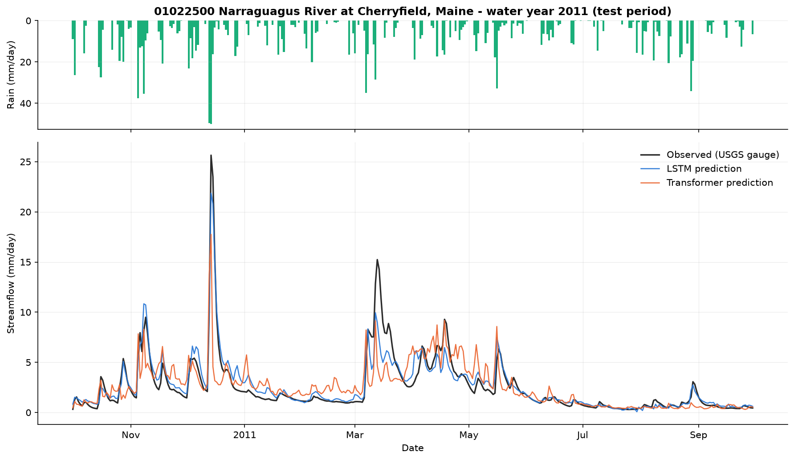
</p>
<p align="center"><i>Narraguagus River (Maine), water year 2011 of the unseen test decade. Rain falls from the top; the river answers below.
Black = USGS gauge, blue = LSTM, orange = Transformer.</i></p>

**Contents** &nbsp;
[Why](#why-this-exists) ·
[Pipeline](#pipeline) ·
[Experiment](#experimental-setup) ·
[Results](#results) ·
[Models](#how-the-two-models-see-the-problem) ·
[App](#interactive-dashboard) ·
[Quick start](#quick-start) ·
[Repository map](#repository-map) ·
[Limitations](#honest-limitations) ·
[Flood Hub](#relation-to-google-flood-hub) ·
[Next steps](#where-to-go-next) ·
[References](#references)

---

## Why this exists

A river basin turns weather into river flow through soil, snow and groundwater. Classical hydrology writes equations
for those stores; **neural hydrology** (Kratzert et al. 2018, 2019) lets a sequence model learn them from data, and the
same idea now runs **Google Flood Hub** for 150+ countries. This repository is the smallest complete, reproducible version
of that workflow that fits on a laptop: real data, two architectures, a fair comparison, honest metrics, an interactive
dashboard and plain-English notes. It was built as a learning and research sandbox, not as a reproduction of Flood Hub.

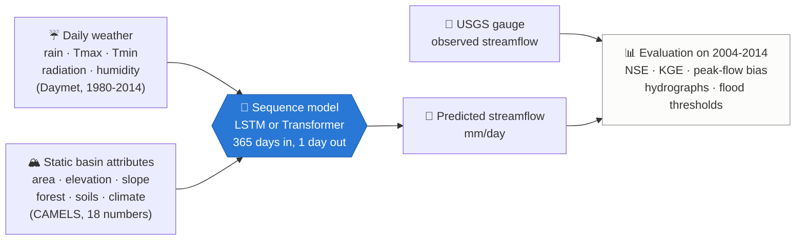

---

## Pipeline

Six scripts, run in order. Every arrow is one command; every box is a folder you can open.

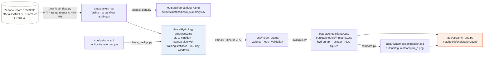

---

## Experimental setup

| | |
|---|---|
| **Dataset** | CAMELS-US (Newman et al. 2015; Addor et al. 2017), NCAR, CC-BY-4.0, fetched from the official Zenodo archive |
| **Basins** | six, chosen for contrasting hydrology (table below) |
| **Period** | daily, 1 Oct 1980 to 30 Sep 2014 (34 water years, no missing flow days) |
| **Dynamic inputs** | 5 Daymet variables per day: precipitation, Tmax, Tmin, solar radiation, vapour pressure; window of 365 days |
| **Static inputs** | 18 CAMELS attributes: area, elevation, slope, forest fraction, leaf-area index, soil depth / porosity / conductivity / sand / clay, mean P, mean PET, aridity, snow fraction, high- and low-precipitation frequency and duration |
| **Target** | observed streamflow in mm/day (USGS discharge divided by basin area) |
| **Split** | chronological: train 1980-1999 (19 water years), validation 1999-2004 (5), **test 2004-2014 (10)** |
| **Leakage guards** | observed flow never an input; flow-derived attributes excluded; normalisation statistics from the training period only; nothing tuned on the test decade |
| **Training** | basin-normalised NSE loss (Kratzert et al. 2019), Adam, batch 256, 30 epochs, gradient clipping 1, seed 42; identical for both models (`scripts/check_configs.py` asserts 27 shared settings) |
| **Hardware / software** | Apple M1 Max, PyTorch 2.14 (MPS backend, CPU fallback), NeuralHydrology 1.13.0, Python 3.13; exact pins in `requirements.txt` |

| Gauge | River | Area km² | Regime |
|---|---|---:|---|
| 01022500 | Narraguagus River, Maine | 574 | humid, forested, snow + rain |
| 02177000 | Chattooga River, Georgia | 527 | wet Appalachian mountains, rain-driven |
| 07057500 | North Fork River, Missouri | 1456 | Ozark karst, groundwater-fed recessions |
| 08171300 | Blanco River, Texas | 1067 | semi-arid flash floods, dry on 22 % of days |
| 11532500 | Smith River, California | 1578 | Pacific coast, extreme winter storms |
| 13235000 | South Fork Payette River, Idaho | 1163 | high-elevation snowmelt |

What one basin's data looks like (Narraguagus River, October 2010):

```
            prcp(mm/day)  tmax(C)  tmin(C)  QObs(mm/d)
2010-10-01          8.86    20.87    14.50        0.32
2010-10-02         26.42    19.10     9.67        1.31   <- 26 mm storm: river rises the same day
2010-10-03          0.00    16.43     2.60        1.54   <- peak one day later
2010-10-04          0.00    15.13     5.15        1.09   <- recession
```

<p align="center">
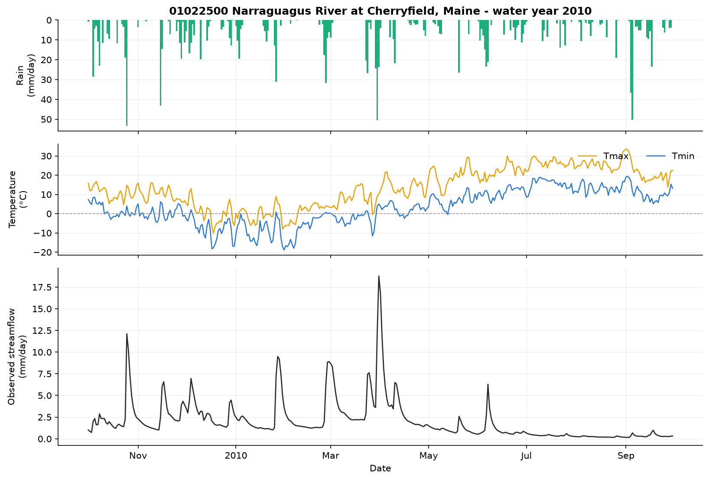
</p>
<p align="center"><i>Phase 1 before any model: rain (top), temperature (middle) and observed flow (bottom) for one water year. Every rain bar has an answer in the river, delayed by storage.</i></p>

---

## Results

All scores are on the **test decade 2004-2014**, which neither model saw during training or model selection.
Median over the six basins (full tables in [`outputs/metrics/comparison.md`](outputs/metrics/comparison.md)):

| Model | Median NSE | Median KGE | r (timing) | α (variability) | β (bias) | Peak-flow bias FHV | Parameters | Training |
|---|---:|---:|---:|---:|---:|---:|---:|---:|
| **LSTM** (64 cells) | **0.796** | **0.730** | 0.903 | 0.843 | 1.011 | −9.7 % | 22 849 | 4.9 min |
| Transformer (2 layers, 4 heads) | 0.451 | 0.641 | 0.701 | 0.772 | 1.032 | −21.2 % | 67 809 | 32.7 min |

<table align="center">
<tr>
<td width="50%">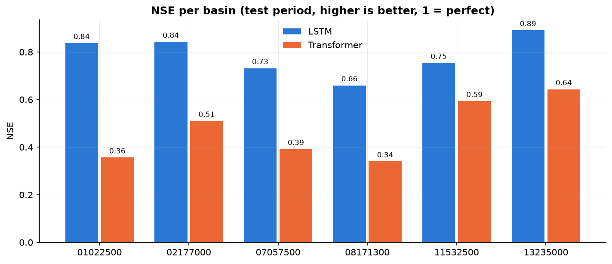</td>
<td width="50%">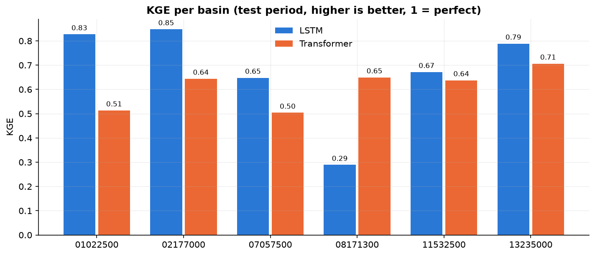</td>
</tr>
<tr>
<td><i>NSE per basin: the LSTM leads everywhere (1 = perfect, 0 = no better than the mean flow).</i></td>
<td><i>KGE per basin: the LSTM leads in five of six; on the dry Blanco River its volume bias (+68 %) costs it the KGE.</i></td>
</tr>
</table>

| Basin | River and regime | LSTM NSE / KGE | Transformer NSE / KGE |
|---|---|---:|---:|
| 01022500 | Narraguagus, Maine · snow + rain | 0.84 / 0.83 | 0.36 / 0.51 |
| 02177000 | Chattooga, Georgia · wet mountains | 0.84 / 0.85 | 0.51 / 0.64 |
| 07057500 | North Fork, Missouri · karst springs | 0.73 / 0.65 | 0.39 / 0.50 |
| 08171300 | Blanco, Texas · flash floods | 0.66 / 0.29 | 0.34 / 0.65 |
| 11532500 | Smith, California · winter storms | 0.75 / 0.67 | 0.59 / 0.64 |
| 13235000 | SF Payette, Idaho · snowmelt | 0.89 / 0.79 | 0.64 / 0.71 |

### Extreme events: the highest observed daily flow of the decade in each basin

| Basin | Date | Rain that day | Rain previous 3 days | Observed | LSTM | Transformer |
|---|---|---:|---:|---:|---:|---:|
| Narraguagus | 2007-04-18 | 16.7 mm | 79.7 mm | 26.5 | 20.1 | 8.0 |
| Chattooga | 2009-09-20 | 78.3 mm | 53.4 mm | 32.3 | 10.8 | 11.5 |
| North Fork | 2011-04-26 | 64.4 mm | 164.2 mm | 68.2 | 30.9 | 14.8 |
| Blanco | 2013-10-31 | 87.2 mm | 5.2 mm | 38.3 | 16.3 | 17.4 |
| Smith | 2008-12-28 | 90.3 mm | 67.7 mm | 118.4 | 36.2 | 34.2 |
| SF Payette | 2010-06-05 | 3.6 mm | 75.8 mm | 16.2 | 5.7 | 7.9 |

<sub>Flows in mm/day. Both models under-predict every one of these peaks by a factor of two to three. A high daily discharge does not by itself confirm that flooding occurred, so these are called high-flow events, not floods.</sub>

<p align="center">
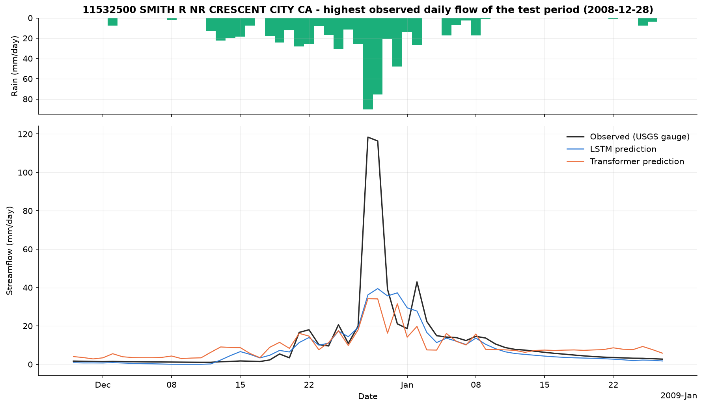
</p>
<p align="center"><i>Smith River, California, December 2008, the highest daily flow of the test decade: four days of 50 to 90 mm of rain, a 118 mm/day observed peak, and two models that saturate near 35 mm/day.</i></p>

<table align="center">
<tr>
<td width="50%">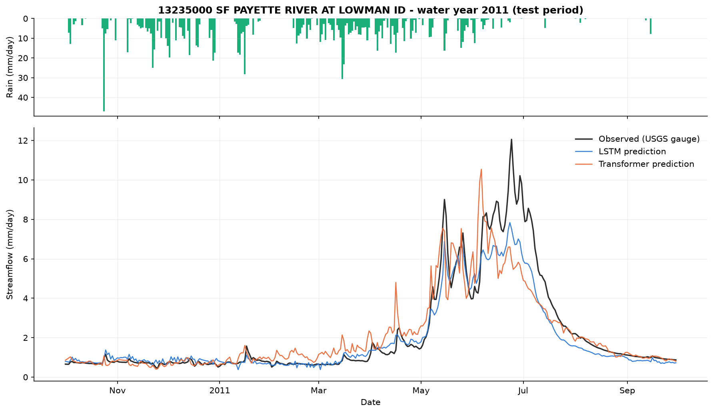</td>
<td width="50%">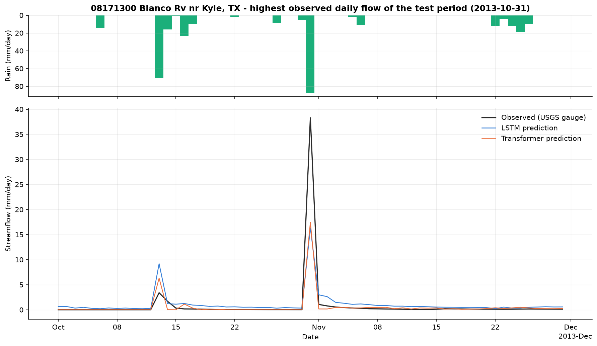</td>
</tr>
<tr>
<td><i>South Fork Payette (Idaho), water year 2011: winter precipitation is stored as snow and released in May to July. The LSTM's recurrent state tracks the slow release; the Transformer is noisier and early.</i></td>
<td><i>Blanco River (Texas), October 2013: 87 mm of rain on a dry basin produced 38 mm/day; both models predicted about 17. Sharp responses on dry soils remain the hardest case.</i></td>
</tr>
</table>

### What the numbers say, honestly

* At this identical, small training budget the **LSTM wins on every basin by NSE**, consistent with large-sample studies
  (Liu et al. 2025, *HESS*): recurrent memory cells behave like water stores; attention over 365 separate days does not.
* This is **not a verdict on Transformers**: the Transformer's validation loss was still falling at epoch 30, it has three
  times the parameters to fit from about 41 000 samples, and nothing was tuned. The fair, reproducible pipeline for a
  bigger comparison is the deliverable.
* **Extreme flows are under-predicted by both models.** The highest daily flow of the decade is missed by a factor of two to
  three in every basin; peak-flow bias (FHV) is negative almost everywhere. Rare events are a handful of days in 19
  training years and the NSE loss gives them no special weight.
* **Dry basins are hard.** The LSTM over-predicts low flows in the Blanco basin (+68 % volume, KGE 0.29) and never produces
  the zero flows that occur on 22 % of its days; the Transformer gets the volume right there but the timing wrong.
* Visually, the Transformer hydrograph jitters from day to day while the LSTM is smooth, which is what you expect from
  a model with versus without a persistent state.

---

## How the two models see the problem

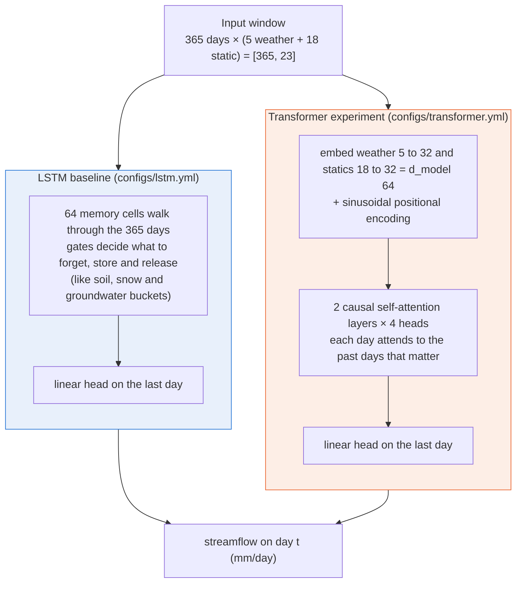

| | LSTM | Transformer |
|---|---|---|
| NeuralHydrology class | `cudalstm` (PyTorch `nn.LSTM`, 1 layer; the name is historical, it runs on CPU and MPS) | `transformer` (PyTorch `TransformerEncoder`, causal mask) |
| Inputs | raw 23 features per day | FC embeddings to d_model 64, sinusoidal positional encoding |
| Core | 64 cells, forget-gate bias 3 | 2 layers × 4 heads, feed-forward 128, dropout 0.1 |
| Head | linear, output dropout 0.4 | same |
| Learning rate | 1e-3 → 5e-4 → 1e-4 | 5e-4 → 2e-4 → 5e-5 |
| Parameters | 22 849 | 67 809 |

Plain-English explanations of every term, with numbers from this data: [`LEARNING_NOTES.md`](LEARNING_NOTES.md).

---

## Interactive dashboard

```bash
streamlit run app/streamlit_app.py --server.port 8502
```

<p align="center">
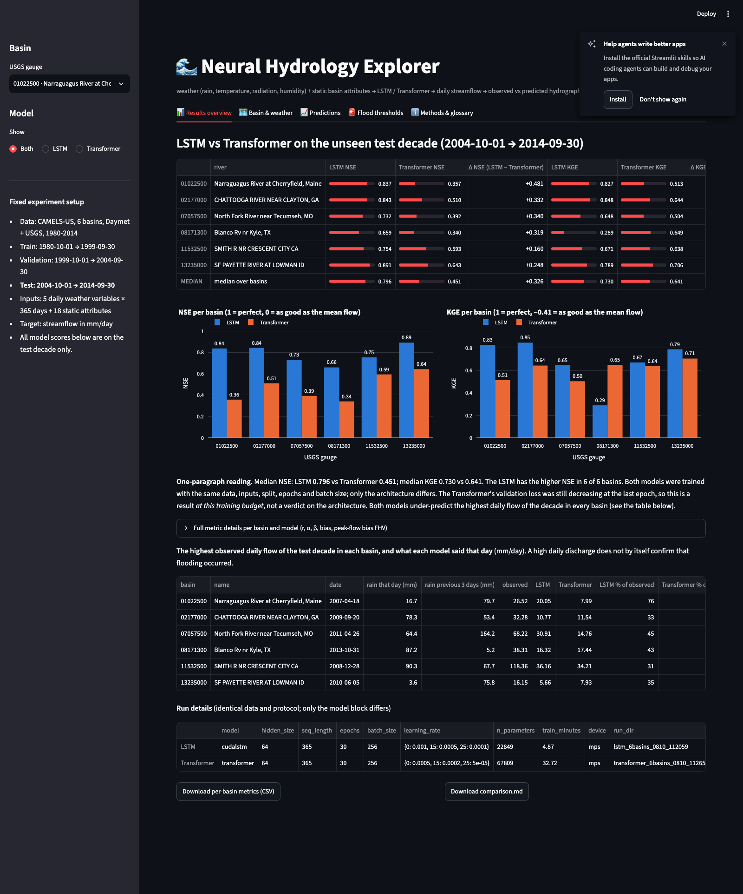
</p>
<p align="center"><i>Results overview: both models side by side, per basin and as a median, with the highest-flow-event table and run details.</i></p>

| Tab | What it shows |
|---|---|
| **📊 Results overview** | LSTM vs Transformer table with a median row, Δ per basin, NSE / KGE charts, extreme-event table, run details, CSV download |
| **🗺️ Basin & weather** | map of the six gauges, attributes with meanings, water balance, rain + temperature + flow with one-click windows |
| **📈 Predictions** | observed vs predicted hydrograph with windows that pick themselves (highest flow, wettest year, best / worst year), year-by-year scores, scatter, flow-duration curve, seasonal regime |
| **🚨 Flood thresholds** | educational 2 / 5 / 10-year return levels from the pre-test annual maxima (the Flood Hub warning / danger / extreme idea), with hits, misses and false alarms per model |
| **ℹ️ Methods & glossary** | exact inputs, target, split, model sizes; plain-English definitions |

<table align="center">
<tr>
<td width="50%">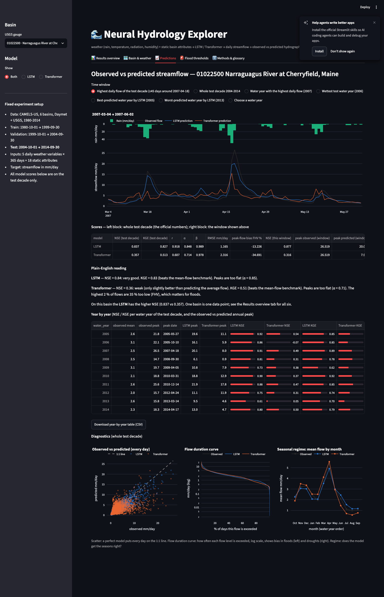</td>
<td width="50%">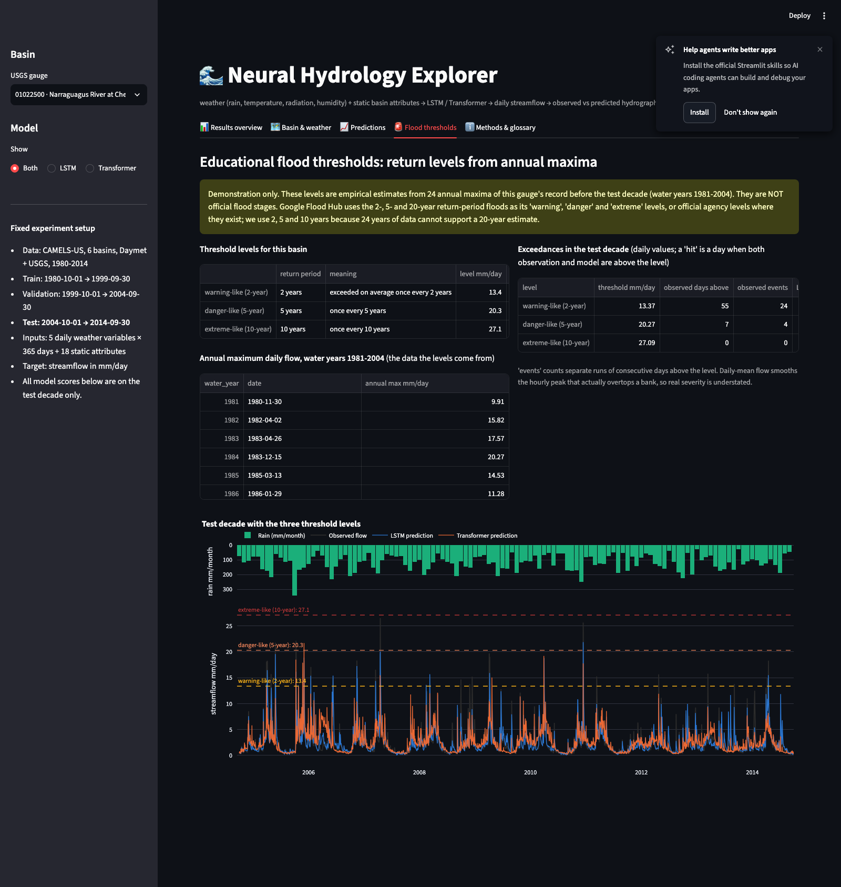</td>
</tr>
<tr>
<td><i>Predictions tab: self-selecting time windows, year-by-year scores and diagnostics.</i></td>
<td><i>Flood thresholds tab: empirical return levels drawn on the test decade, with exceedance counts per model.</i></td>
</tr>
</table>

**Deploy your own copy for free.** Fork the repository, open [share.streamlit.io](https://share.streamlit.io), choose
`app/streamlit_app.py` as the main file, and deploy. The app needs no PyTorch (it reads the committed predictions and
metrics, using `app/requirements.txt`) and downloads the 10 MB of basin data by itself on first start.

---

## Quick start

About 45 minutes end to end on an M1 Max; everything also runs on CPU, and no GPU is assumed anywhere.

```bash
git clone https://github.com/muhammadibrahim313/neural-hydrology-explorer.git
cd neural-hydrology-explorer
python3 -m venv .venv && source .venv/bin/activate
pip install -r requirements.txt && pip install -e .

python scripts/download_data.py        # ~10 MB: six basins straight from the official NCAR archive on Zenodo
python scripts/inspect_data.py         # Phase 1: look at the data before any model
python scripts/train.py --model both   # Phase 2 + 3: LSTM (~5 min) then Transformer (~30 min) on MPS
python scripts/evaluate.py             # predictions, metrics, hydrographs
python scripts/compare.py              # LSTM vs Transformer tables and figures
pytest -q                              # metrics match NeuralHydrology's; loaders agree; the app renders
streamlit run app/streamlit_app.py --server.port 8502
```

The repository already contains the predictions, metrics and figures of the documented run, so the app and the notebook
work right after `download_data.py` (the app even runs that step for you). Conda users: `mamba env create -f environment.yml`.
Reproducibility: fixed seed, pinned versions, provenance of every downloaded file in `data/camels_us/MANIFEST.json`.

---

## Repository map

```
configs/        lstm.yml · transformer.yml · _shared_data_and_split.yml   the experiment, fully commented
scripts/        download_data → inspect_data → train → evaluate → compare  the pipeline, in order
src/nhplay/     loaders · metrics written out line by line · event / return-level tools · plots · run wrapper
app/            streamlit_app.py (+ requirements.txt for a PyTorch-free deployment)
notebooks/      exploration.ipynb, executed
outputs/        figures/ · metrics/ · predictions/   results of the documented run
data/           README.md · basins.txt · camels_us/ (downloaded, git-ignored)
tests/          metrics vs NeuralHydrology · loader equivalence · event tools · app renders
docs/images/    dashboard screenshots
```

| Document | What it is for |
|---|---|
| [`ARCHITECTURE.md`](ARCHITECTURE.md) | the complete map: every file, the data flow, inputs and target, models, results, limitations, how to extend |
| [`LEARNING_NOTES.md`](LEARNING_NOTES.md) | basin, gauge, forcing, hydrograph, NSE, KGE, LSTM, Transformer, floods: explained with numbers from this data |
| [`data/README.md`](data/README.md) | dataset, licence, citation, file formats, the cfs-to-mm/day conversion |
| [`outputs/metrics/comparison.md`](outputs/metrics/comparison.md) | the full result tables of the documented run |
| [`notebooks/exploration.ipynb`](notebooks/exploration.ipynb) | the whole story as one executed notebook |

**Read first:** `LEARNING_NOTES.md` sections 1-8 with `outputs/figures/data_01022500_wy2010.png` open, then `configs/lstm.yml`,
then `outputs/metrics/comparison.md`.

---

## Honest limitations

* Six basins, one seed, 30 epochs, no hyper-parameter search: a learning setup, not a benchmark.
* Simulation from *observed* weather. A real forecast needs weather forecasts as inputs and a multi-day horizon.
* Daily means hide the hourly peaks that cause damage; extremes are under-predicted by both models.
* Flood thresholds in the app are empirical demonstrations from 24 annual maxima, not official flood stages.
* Historical data only (Daymet to 2014, CAMELS attributes from 2017).

---

## Relation to Google Flood Hub

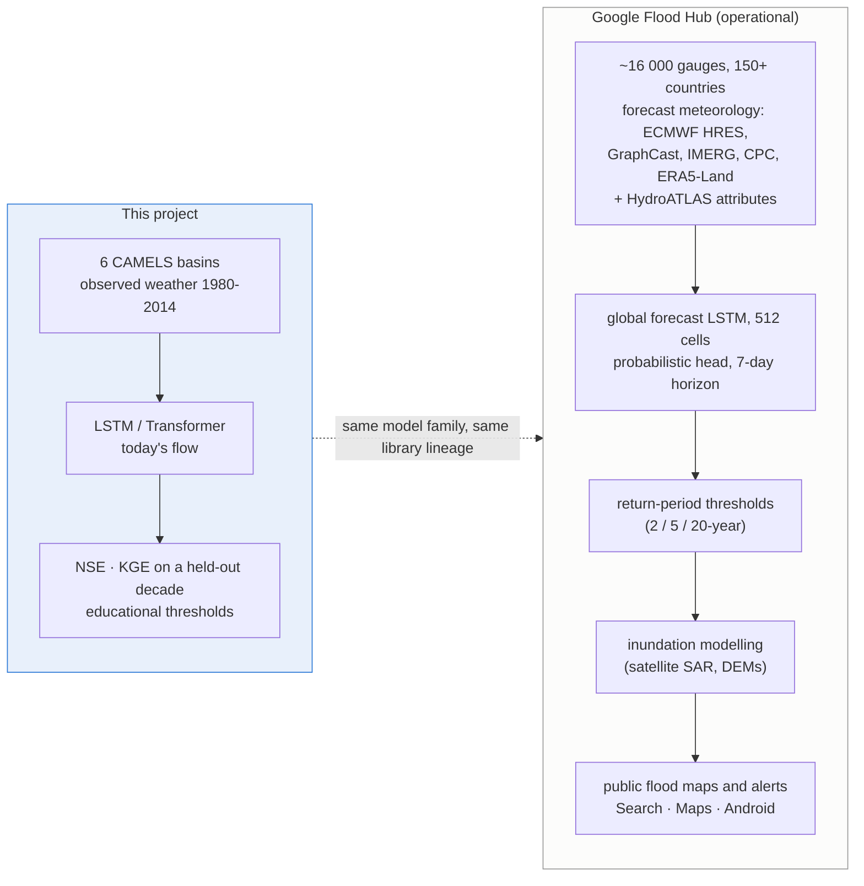

Google open-sourced its framework in June 2026 as **OpenHydroNet**
([github.com/google-research/flood-forecasting](https://github.com/google-research/flood-forecasting), Apache-2.0), a fork
of NeuralHydrology, so the configs and conventions here transfer directly. Its pretrained weights were trained on the
*full* 1982-2023 record with *no temporal hold-out*; the repository's model README warns that evaluating them on historical
dates gives "fundamentally invalid, artificially inflated performance metrics due to in-sample evaluation (data leakage)".
Legitimate uses are fine-tuning, spatially held-out basins, or post-2023 inference. **This project uses no pretrained
weights**, so every number above is genuinely out of sample.

---

## Where to go next

| Direction | What changes |
|---|---|
| Transformer with a fair budget | more epochs, learning-rate search, several seeds; keep the test decade untouched |
| Scale | 50 to 500 CAMELS basins by extending `data/basins.txt` (hours on MPS) |
| Ungauged basins | different ids in `train_basin_file` and `test_basin_file`, then k-fold |
| Extreme events | return-period metrics, hit / miss / false-alarm rates, peak timing |
| Uncertainty | NeuralHydrology's `cmal` or `gmm` heads for probabilistic output |
| Forecast mode | weather forecasts as inputs, multi-day horizon (OpenHydroNet's forecast LSTM) |
| Pakistan basins | Caravan-style data from local gauges + ERA5-Land, transfer learning from a global model |
| Inundation | couple predicted flows to a DEM-based flood-extent model |

Details in [`ARCHITECTURE.md`](ARCHITECTURE.md) section 10.

---

## References

**Data** · Newman et al. (2015) *HESS* 19, 209-223 · Addor et al. (2017) *HESS* 21, 5293-5313 · CAMELS archive DOI
[10.5065/D6MW2F4D](https://doi.org/10.5065/D6MW2F4D) (Zenodo record 15529996, CC-BY-4.0) · Kratzert et al. (2023) Caravan, *Sci. Data* 10, 61.

**Methods** · Hochreiter & Schmidhuber (1997) LSTM · Vaswani et al. (2017) Attention is all you need · Kratzert et al.
(2018) *HESS* 22, 6005 · Kratzert et al. (2019) *HESS* 23, 5089 · Kratzert et al. (2022) NeuralHydrology, *JOSS* 7(71), 4050
([docs](https://neuralhydrology.readthedocs.io)) · Nash & Sutcliffe (1970) · Gupta et al. (2009) KGE · Knoben et al.
(2019) *HESS* 23, 4323 · Liu et al. (2025) Transformers vs LSTMs for rainfall-runoff, *HESS* 29, 6811 · Gauch et al. (2025)
*HESS* 29, 6221.

**Google Flood Hub** · Nearing et al. (2024) Global prediction of extreme floods in ungauged watersheds, *Nature* 627,
559-563 · Cohen et al. (2026) Global Flood Forecasting Model v2, EGUsphere 2026-2283 ·
[OpenHydroNet](https://github.com/google-research/flood-forecasting) · [Flood Hub](https://sites.research.google/floods).

**Licence** · Code MIT ([LICENSE](LICENSE)). Data CAMELS-US CC-BY-4.0; please cite Newman et al. (2015) and Addor et al. (2017).
