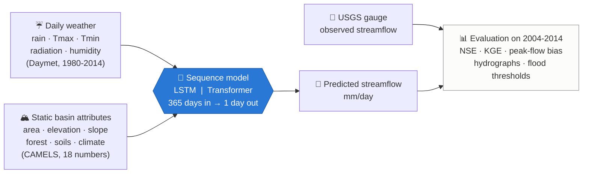
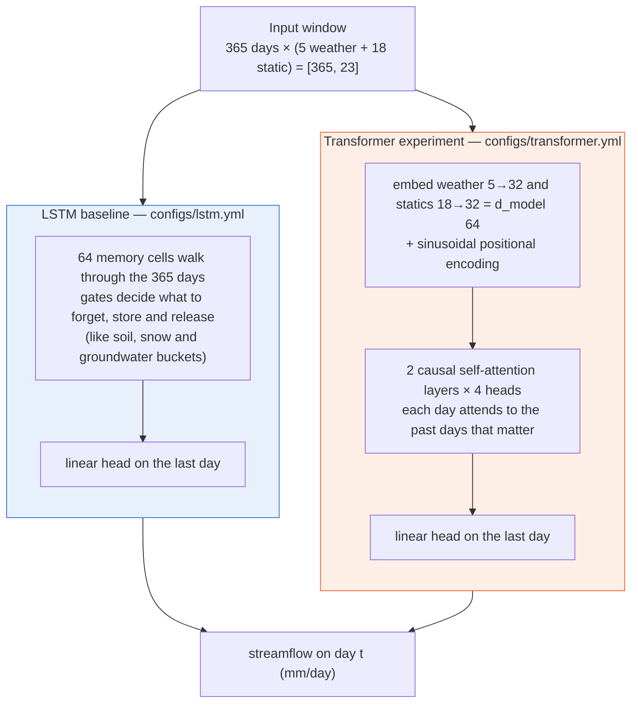
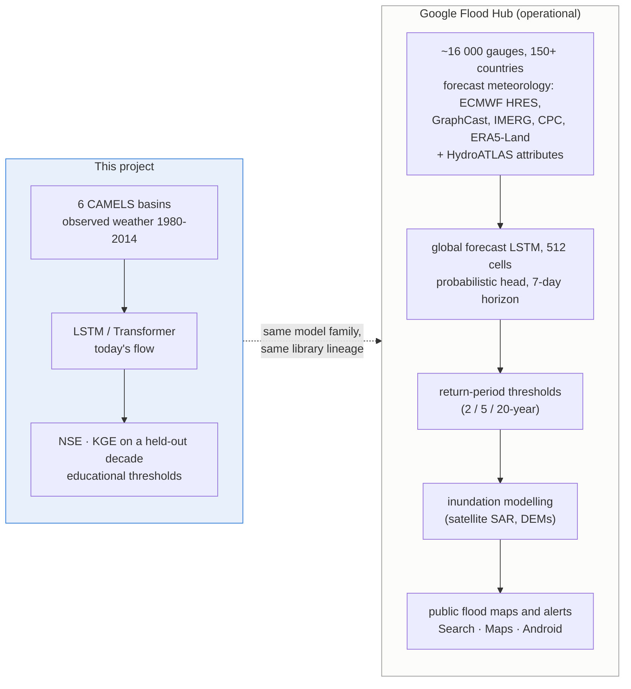

<h1 align="center">🌊 Neural Hydrology Explorer</h1>

<p align="center">
<b>Rain in, river out.</b> An LSTM and a Transformer learn to predict daily streamflow for six real US river basins,
scored honestly on a decade they never saw, with every step explained for someone new to the field.
</p>

<p align="center">


</p>

<p align="center">

</p>
<p align="center"><i>Narraguagus River (Maine), water year 2011 of the unseen test decade: rain falls from the top, the river answers below.
Black = USGS gauge, blue = LSTM, orange = Transformer.</i></p>

---

## Why this exists

A river basin turns weather into river flow through soil, snow and groundwater. Classical hydrology writes equations
for those stores; **neural hydrology** (Kratzert et al. 2018, 2019) lets a sequence model learn them from data, and the
same idea now runs **Google Flood Hub** for 150+ countries. This repository is the smallest complete, reproducible version
of that workflow that fits on a laptop: real data, two architectures, a fair comparison, honest metrics, and plain-English
notes. It was built as a learning and research sandbox, not as a reproduction of Flood Hub.



---

## Results at a glance

Both models: same six basins, same inputs, same target, same chronological split, same epochs and batch size.
Only the architecture differs (`scripts/check_configs.py` enforces this). Scores are on the **test decade
1 Oct 2004 → 30 Sep 2014**, which neither model saw during training or model selection.

| Model | Median NSE | Median KGE | r (timing) | α (variability) | β (bias) | Peak-flow bias FHV | Parameters | Training |
|---|---:|---:|---:|---:|---:|---:|---:|---:|
| **LSTM** (64 cells) | **0.796** | **0.730** | 0.903 | 0.843 | 1.011 | −9.7 % | 22 849 | 4.9 min |
| Transformer (2 layers, 4 heads) | 0.451 | 0.641 | 0.701 | 0.772 | 1.032 | −21.2 % | 67 809 | 32.7 min |

<p align="center">

</p>

| Basin | River and regime | LSTM NSE / KGE | Transformer NSE / KGE |
|---|---|---:|---:|
| 01022500 | Narraguagus, Maine · snow + rain | 0.84 / 0.83 | 0.36 / 0.51 |
| 02177000 | Chattooga, Georgia · wet mountains | 0.84 / 0.85 | 0.51 / 0.64 |
| 07057500 | North Fork, Missouri · karst springs | 0.73 / 0.65 | 0.39 / 0.50 |
| 08171300 | Blanco, Texas · flash floods, dry 22 % of days | 0.66 / 0.29 | 0.34 / 0.65 |
| 11532500 | Smith, California · huge winter storms | 0.75 / 0.67 | 0.59 / 0.64 |
| 13235000 | SF Payette, Idaho · snowmelt | 0.89 / 0.79 | 0.64 / 0.71 |

**What the numbers say, honestly**

* At this (small, identical) training budget the **LSTM wins on every basin**. This agrees with large-sample studies
  (Liu et al. 2025, *HESS*): recurrent memory cells behave like water stores; attention over 365 separate days does not.
* It is **not** a verdict on Transformers: the Transformer's validation loss was still falling at epoch 30, it has three
  times the parameters to fit from ~41 000 samples, and nothing was tuned. The pipeline for a fair, bigger comparison is
  the deliverable.
* **Both models under-predict the biggest flood of the decade in every basin** by a factor of 2 to 3. On the Smith River
  on 28 Dec 2008 the gauge recorded 118 mm/day; the LSTM said 36, the Transformer 34.
* The LSTM **over-predicts low flows in the dry Blanco basin** (+68 % volume); it never produces the zero flows that
  occur on 22 % of its days.

<p align="center">

</p>
<p align="center"><i>The largest flood of the test decade (Smith River, California): four days of 50 to 90 mm of rain, a 118 mm/day peak, and two models that saturate near 35 mm/day.</i></p>

Full tables: [`outputs/metrics/comparison.md`](outputs/metrics/comparison.md).

---

## What the data looks like

Six CAMELS-US basins chosen for very different behaviour (snowmelt, karst, flash floods, Pacific storms). Each day the
model sees five weather numbers; each basin brings 18 fixed attributes; the target is the gauge flow converted to a
depth over the basin so that rain and river share the unit mm/day.

```
            prcp(mm/day)  tmax(C)  tmin(C)  QObs(mm/d)        Narraguagus River, October 2010
2010-10-01          8.86    20.87    14.50        0.32
2010-10-02         26.42    19.10     9.67        1.31   <- 26 mm storm: river rises the same day
2010-10-03          0.00    16.43     2.60        1.54   <- peak one day later
2010-10-04          0.00    15.13     5.15        1.09   <- recession
```

<p align="center">

</p>

| Role | Variables | Why the river cares |
|---|---|---|
| **Dynamic inputs** (365 days) | precipitation, max / min temperature, solar radiation, vapour pressure | water supply; rain or snow; melt and evaporation energy; air dryness |
| **Static inputs** (18 per basin) | area, elevation, slope, forest fraction, leaf area, soil depth / porosity / conductivity / sand / clay, mean P and PET, aridity, snow fraction, wet- and dry-spell statistics | tells one shared model *which* basin it is looking at |
| **Target** (1 number) | observed streamflow, mm/day | what we want to predict |

Observed flow is never an input, and attributes derived from flow are excluded, so nothing leaks. Details and file
formats: [`data/README.md`](data/README.md). Every concept with worked numbers: [`LEARNING_NOTES.md`](LEARNING_NOTES.md).

---

## How the two models see the problem



Training: basin-normalised NSE loss (Kratzert et al. 2019), Adam, batch 256, 30 epochs, seed 42, Apple MPS (CPU fallback).
Split: train 1980-1999 · validation 1999-2004 · **test 2004-2014**.

---

## Explore it in the app

```bash
streamlit run app/streamlit_app.py --server.port 8502
```

<p align="center">

</p>

| Tab | What it shows |
|---|---|
| **📊 Results overview** | LSTM vs Transformer table with a median row, Δ per basin, NSE / KGE charts, biggest-flood table, run details, CSV download |
| **🗺️ Basin & weather** | map of the six gauges, attributes with meanings, water balance, rain + temperature + flow with one-click windows |
| **📈 Predictions** | observed vs predicted hydrograph with windows that pick themselves (largest flood, wettest year, best / worst year), year-by-year scores, scatter, flow-duration curve, seasonal regime |
| **🚨 Flood thresholds** | educational 2 / 5 / 10-year return levels from the pre-test annual maxima (the Flood Hub warning / danger / extreme idea), with hits, misses and false alarms per model |
| **ℹ️ Methods & glossary** | exact inputs, target, split, model sizes; plain-English definitions |

<p align="center">

</p>

---

## Quick start (about 45 minutes end to end on an M1 Max; everything also runs on CPU)

```bash
git clone https://github.com/muhammadibrahim313/neural-hydrology-explorer.git
cd neural-hydrology-explorer
python3 -m venv .venv && source .venv/bin/activate
pip install -r requirements.txt && pip install -e .

python scripts/download_data.py        # ~10 MB: six basins straight from the official NCAR archive on Zenodo
python scripts/inspect_data.py         # Phase 1: look at the data before any model
python scripts/train.py --model both   # Phase 2 + 3: LSTM (~5 min) then Transformer (~30 min) on MPS
python scripts/evaluate.py             # predictions, metrics, hydrographs
python scripts/compare.py              # LSTM vs Transformer tables and figures
pytest -q                              # metrics match NeuralHydrology's; the app renders
streamlit run app/streamlit_app.py --server.port 8502
```

The repository already contains the predictions, metrics and figures of the run described above, so the app and the
notebook work right after `download_data.py`, before you train anything. Conda users: `mamba env create -f environment.yml`.

---

## Repository map

```
configs/        lstm.yml · transformer.yml · _shared_data_and_split.yml   (the experiment, fully commented)
scripts/        download_data → inspect_data → train → evaluate → compare  (the pipeline, in order)
src/nhplay/     data loaders · metrics written out line by line · event/return-level tools · plots · run wrapper
app/            streamlit_app.py
notebooks/      exploration.ipynb (executed)
outputs/        figures/ · metrics/ · predictions/   (results of the documented run)
data/           README.md · basins.txt · camels_us/ (downloaded, git-ignored)
tests/          metrics vs NeuralHydrology · event tools · app renders
LEARNING_NOTES.md   every term explained with real numbers        ARCHITECTURE.md   the full map, file by file
```

**Read first:** `LEARNING_NOTES.md` sections 1-8 with `outputs/figures/data_01022500_wy2010.png` open, then `configs/lstm.yml`,
then `outputs/metrics/comparison.md`.

---

## Honest limitations

* Six basins, one seed, 30 epochs, no hyper-parameter search: a learning setup, not a benchmark.
* Simulation from *observed* weather. A real forecast needs weather forecasts as inputs and a multi-day horizon.
* Daily means hide the hourly peaks that cause damage; extremes are under-predicted by both models.
* Flood thresholds in the app are empirical demonstrations from 24 annual maxima, not official flood stages.
* Historical data only (Daymet to 2014, CAMELS attributes 2017).

---

## Relation to Google Flood Hub



Google open-sourced its framework in June 2026 as **OpenHydroNet**
([github.com/google-research/flood-forecasting](https://github.com/google-research/flood-forecasting), Apache-2.0), a fork
of NeuralHydrology, so the configs and conventions here transfer directly. Its pretrained weights were trained on the
*full* 1982-2023 record with *no temporal hold-out*; the repository's model README warns that evaluating them on historical
dates gives "fundamentally invalid, artificially inflated performance metrics due to in-sample evaluation (data leakage)".
Legitimate uses are fine-tuning, spatially held-out basins, or post-2023 inference. **This project uses no pretrained
weights**, so every number above is genuinely out of sample.

---

## Where to go next

Transformer with a fair budget (more epochs, learning-rate search, several seeds) · 50-500 CAMELS basins ·
prediction in ungauged basins (train on some basins, test on others) · extreme-event metrics with return periods ·
probabilistic heads (CMAL) for uncertainty · forecast mode with weather forecasts · Pakistan river basins via
Caravan-style data and transfer learning from a global model · coupling predicted flows to inundation maps.
Each is a config or basin-list change away; see [`ARCHITECTURE.md`](ARCHITECTURE.md) section 10.

---

## References

**Data** · Newman et al. (2015) *HESS* 19, 209-223 · Addor et al. (2017) *HESS* 21, 5293-5313 · CAMELS archive DOI
[10.5065/D6MW2F4D](https://doi.org/10.5065/D6MW2F4D) (Zenodo record 15529996, CC-BY-4.0) · Kratzert et al. (2023) Caravan, *Sci. Data* 10, 61.

**Methods** · Hochreiter & Schmidhuber (1997) LSTM · Vaswani et al. (2017) Attention is all you need · Kratzert et al.
(2018) *HESS* 22, 6005 · Kratzert et al. (2019) *HESS* 23, 5089 · Kratzert et al. (2022) NeuralHydrology, *JOSS* 7(71), 4050
([docs](https://neuralhydrology.readthedocs.io)) · Nash & Sutcliffe (1970) · Gupta et al. (2009) KGE · Knoben et al.
(2019) *HESS* 23, 4323 · Liu et al. (2025) Transformers vs LSTMs for rainfall-runoff, *HESS* 29, 6811 · Gauch et al. (2025)
*HESS* 29, 6221.

**Google Flood Hub** · Nearing et al. (2024) Global prediction of extreme floods in ungauged watersheds, *Nature* 627,
559-563 · Cohen et al. (2026) Global Flood Forecasting Model v2, EGUsphere 2026-2283 ·
[OpenHydroNet](https://github.com/google-research/flood-forecasting) · [Flood Hub](https://sites.research.google/floods).

**Licence** · Code MIT ([LICENSE](LICENSE)). Data CAMELS-US CC-BY-4.0; please cite Newman et al. (2015) and Addor et al. (2017).
